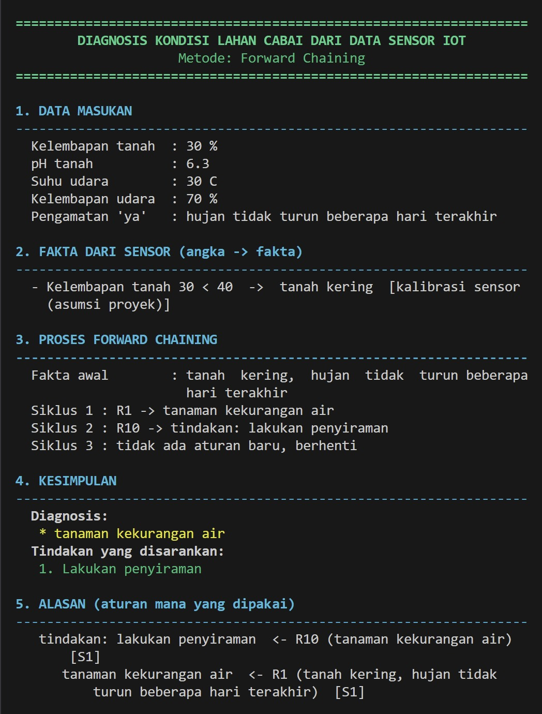
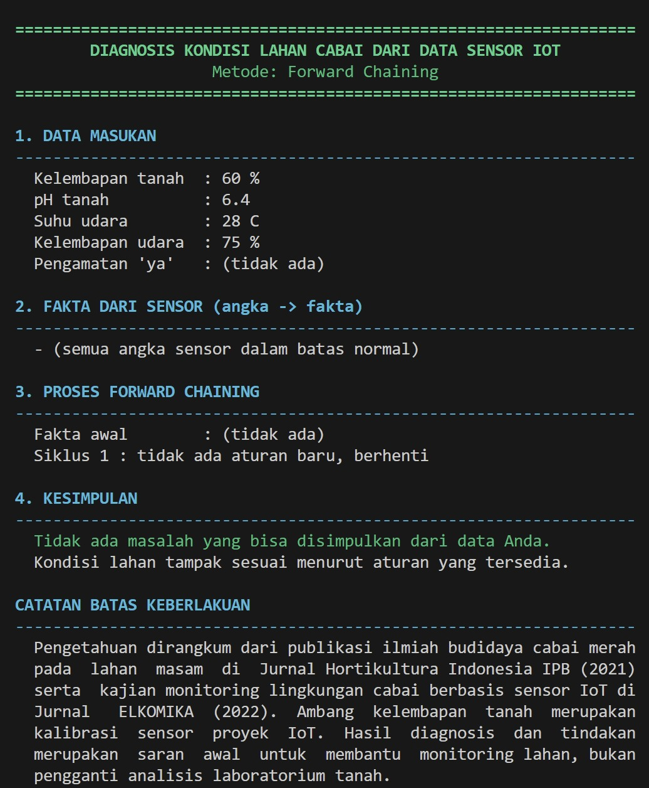
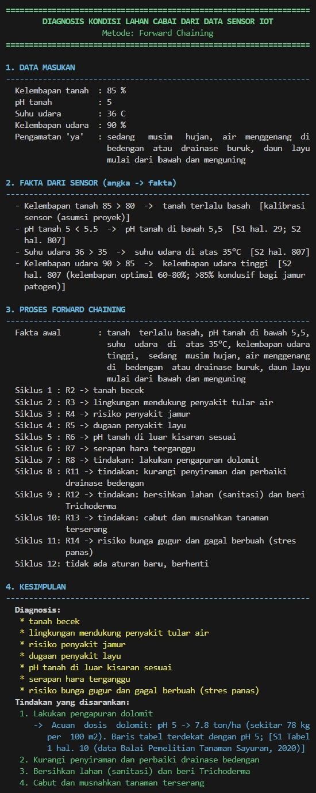
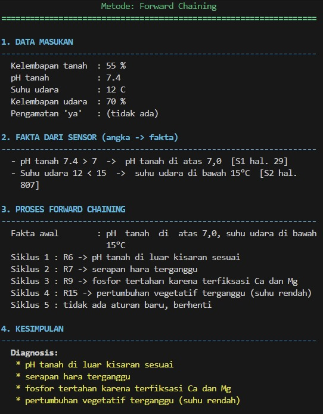

# Diagnosis Kondisi Lahan Cabai dari Data Sensor IoT (Forward Chaining)

**Nama:** NI PUTU AYU DIAN SULASTRI  **NIM:** F1D02510021

Sistem pakar sederhana untuk *smart agriculture*: program membaca data sensor lahan cabai (kelembapan tanah, pH tanah, suhu udara, kelembapan udara) dan pengamatan petani, lalu menyimpulkan masalah lahan beserta **tindakan yang disarankan** dan **alasannya** (aturan mana yang dipakai). Mesin forward chaining ditulis sendiri tanpa library sistem pakar.

## Cara menjalankan
- Bahasa: Python 3.10+ (diuji pada Python 3.12), hanya menggunakan library bawaan (*standard library*).
- Mode tanya: `python main.py`
- Mode baca file (meniru data dari alat IoT): `python main.py --file kasus/kasus1.json`
- Cetak tabel aturan: `python main.py --tabel`
- Tes: `python test_cabai.py` (atau `pytest`)

## Struktur file
| File | Fungsi |
|---|---|
| `kb_cabai.json` | Pengetahuan: sumber, ambang sensor, pertanyaan, dan 15 aturan IF-THEN (tiap aturan menunjuk sumber dan halaman) |
| `engine.py` | Mesin forward chaining (tidak tahu soal cabai, bisa dipakai ulang) |
| `sensor.py` | Mengubah angka sensor menjadi fakta memakai ambang di JSON |
| `main.py` | Program utama: masukan, tampilan, kesimpulan, alasan |
| `kasus/` | Data uji dalam format JSON |
| `test_cabai.py` | Tes otomatis |

## Sumber
| Kode | Sumber |
|---|---|
| S1 | Syukur, M., Sujiprihati, S., & Koswara, J. (2021). *Evaluasi Paket Teknologi Budidaya Hibrida Cabai Merah untuk Hasil Tinggi di Lahan Masam*. Jurnal Hortikultura Indonesia (Departemen Agronomi & Hortikultura IPB University), 12(1), hal. 21–30. DOI: [10.29244/jhi.12.1.21-30](https://doi.org/10.29244/jhi.12.1.21-30) (Akses terbuka: https://journal.ipb.ac.id/index.php/jhi/article/view/33420). Diakses 13 November 2026. |
| S2 | Wicaksono, M.F. & Syahrin, A. (2022). *Penerapan IoT untuk Monitoring Suhu dan Kelembaban pada Tanaman Cabai*. Jurnal ELKOMIKA (Institut Teknologi Nasional Bandung), 10(3), hal. 568–578. DOI: [10.26760/elkomika.v10i3.568](https://doi.org/10.26760/elkomika.v10i3.568) (Akses terbuka: https://ejurnal.itenas.ac.id/index.php/elkomika/article/view/568). Diakses 13 November 2026. |

## Tabel aturan
| Aturan | IF | THEN | Sumber |
|---|---|---|---|
| R1 | tanah kering DAN hujan tidak turun beberapa hari terakhir | tanaman kekurangan air | S1 |
| R2 | tanah terlalu basah ATAU air menggenang di bedengan atau drainase buruk | tanah becek | S1 |
| R3 | tanah becek DAN sedang musim hujan | lingkungan mendukung penyakit tular air | S1 |
| R4 | lingkungan mendukung penyakit tular air ATAU kelembapan udara tinggi | risiko penyakit jamur | S1,S2 |
| R5 | risiko penyakit jamur DAN daun layu mulai dari bawah dan menguning | dugaan penyakit layu | S1 |
| R6 | pH tanah di bawah 5,5 ATAU pH tanah di atas 7,0 | pH tanah di luar kisaran sesuai | S1,S2 |
| R7 | pH tanah di luar kisaran sesuai | serapan hara terganggu | S1,S2 |
| R8 | serapan hara terganggu DAN pH tanah di bawah 5,5 | tindakan: lakukan pengapuran dolomit | S1 |
| R9 | serapan hara terganggu DAN pH tanah di atas 7,0 | fosfor tertahan karena terfiksasi Ca dan Mg | S1 |
| R10 | tanaman kekurangan air | tindakan: lakukan penyiraman | S1 |
| R11 | tanah becek | tindakan: kurangi penyiraman dan perbaiki drainase bedengan | S1 |
| R12 | risiko penyakit jamur | tindakan: bersihkan lahan (sanitasi) dan beri Trichoderma | S1 |
| R13 | dugaan penyakit layu | tindakan: cabut dan musnahkan tanaman terserang | S1 |
| R14 | suhu udara di atas 35°C | risiko bunga gugur dan gagal berbuah (stres panas) | S2 |
| R15 | suhu udara di bawah 15°C | pertumbuhan vegetatif terganggu (suhu rendah) | S2 |

Rantai contoh: R2 (tanah becek) -> R3 (lingkungan mendukung penyakit tular air) -> R4 (risiko penyakit jamur) -> R5 (dugaan penyakit layu) -> R13 (tindakan: cabut dan musnahkan tanaman terserang).

### Ambang sensor (angka -> fakta)
| Sensor | Ambang | Fakta | Asal |
|---|---|---|---|
| Kelembapan tanah | < 40% / > 80% | tanah kering / tanah terlalu basah | **Kalibrasi sensor (asumsi proyek), bukan dari sumber** |
| pH tanah | < 5,5 / > 7,0 | pH di bawah 5,5 / di atas 7,0 | S1 hal. 29, S2 hal. 807 |
| Suhu udara | > 35°C / < 15°C | suhu di atas 35°C / di bawah 15°C | S2 hal. 807 |
| Kelembapan udara | > 85% | kelembapan udara tinggi | S2 hal. 807 (optimal 60–80%; >85% kondusif bagi spora jamur patogen) |

Catatan sumber: S1 menyebutkan pH sesuai berada pada kisaran 6,0–7,0 pada satu bagian dan 5,5–6,8 pada bagian lain, sedangkan S2 menyebut kisaran optimal 5,5–6,8. Oleh karena itu, sistem menetapkan ambang batas bawah 5,5 dan batas atas 7,0 sebagai rentang toleransi aman bagi tanaman cabai merah. Nilai pH < 5,5 dikategorikan terlalu masam (ketersediaan hara esensial seperti fosfor menurun drastis), sedangkan pH > 7,0 dikategorikan terlalu basa (unsur fosfor terfiksasi oleh kalsium dan magnesium sehingga sulit diserap).

## Metode: Forward Chaining
Metode inferensi yang digunakan adalah **Forward Chaining** (pelacakan maju), yaitu proses penalaran yang bermula dari fakta-fakta yang telah diketahui (data numerik sensor dan hasil observasi visual lahan) lalu mencocokkan aturan (*production rules*) secara iteratif untuk menarik kesimpulan baru serta menentukan rekomendasi tindakan. Alasan pemilihan metode ini:
1. **Pendekatan *Data-Driven*:** Data kondisi lahan diperoleh secara berkala dari sensor IoT (suhu, kelembapan, pH). Fakta-fakta ini sudah tersedia di awal, sehingga alur logisnya bergerak maju dari fakta menuju kesimpulan (*bottom-up*).
2. **Kesesuaian Rantai Diagnosis:** Gangguan pertanian sering kali terjadi secara kausal/berantai (misal: tanah terlalu basah -> tanah becek -> lingkungan kondusif patogen tular air -> risiko jamur -> anjuran perbaikan drainase & pemberian Trichoderma).
3. **Kemudahan Transparansi & Eksplanasi:** Petani memerlukan penjelasan mengapa sebuah tindakan disarankan. Forward chaining memungkinkan pelacakan pohon alasan (*explanation facility*) secara jelas dari aturan yang terpicu.

Langkah kerja: (1) Nilai sensor dikonversi menjadi fakta melalui ambang batas, (2) Fakta sensor dan observasi dimasukkan ke dalam memori kerja (*working memory*), (3) Sistem memindai aturan yang seluruh premisnya terpenuhi dan kesimpulannya belum ada di memori, (4) Kesimpulan aturan ditambahkan ke memori kerja, (5) Proses diulang hingga tidak ada lagi aturan baru yang dapat dibangkitkan.

## Kasus uji
| # | Masukan | Kesimpulan |
|---|---|---|
| 1 | tanah 30%, pH 6,3, 30°C, RH 70%, hujan tidak turun | tanaman kekurangan air -> tindakan: lakukan penyiraman |
| 2 | semua normal (tanah 60%, pH 6,4, 28°C, RH 75%) | tidak ada kesimpulan (kondisi normal / negatif) |
| 3 | tanah 85%, pH 5,0, 36°C, RH 90%, musim hujan, menggenang, daun layu | becek, jamur, layu, hara terganggu, dolomit, stres panas, dan 4 tindakan |
| 4 | pH 7,4, suhu 12°C | fosfor tertahan karena terfiksasi Ca dan Mg, pertumbuhan vegetatif terganggu |

## Batas keberlakuan
Basis pengetahuan sistem ini bersumber dari kajian agronomi budidaya cabai merah di lahan masam pada *Jurnal Hortikultura Indonesia* IPB (2021) serta penerapan sistem monitoring iklim mikro lahan cabai berbasis IoT pada *Jurnal ELKOMIKA* (2022). Sistem ini ditujukan khusus untuk tanaman cabai merah (*Capsicum annuum L.*) pada lahan terbuka di wilayah beriklim tropis Indonesia. Ambang batas kelembapan tanah merupakan kalibrasi sensor (asumsi teknis proyek) dan perlu disesuaikan kembali dengan karakteristik tekstur tanah setempat (misal: tanah lempung berliat vs tanah pasir). Hasil diagnosis dan anjuran tindakan merupakan rekomendasi awal (*early warning support*) untuk membantu monitoring lahan, bukan vonis mutlak pengganti uji laboratorium tanah atau bimbingan penyuluh pertanian lapangan (PPL).

## Penggunaan alat bantu AI
Sesuai dengan ketentuan pedoman tugas, AI digunakan sebagai alat bantu belajar dan eksplorasi teknis:
1. **Peran AI:** Bantuan AI (Google Antigravity / Gemini) digunakan dalam penyusunan struktur kerangka kode Python (*boilerplate* algoritma forward chaining di `engine.py`), pemformatan penataan skema `kb_cabai.json`, serta perapian tata letak tampilan teks output terminal (*justified text wrapping*).
2. **Kontribusi Mandiri:** Mahasiswa melakukan penelusuran mandiri terhadap literatur ilmiah (jurnal IPB dan jurnal ELKOMIKA), merumuskan 15 relasi sebab-akibat aturan IF-THEN beserta ambang batas sensor, merancang skenario pengujian kasus uji (kasus 1–4), serta mempelajari dan memahami sepenuhnya setiap alur baris kode inferensi yang dieksekusi.
